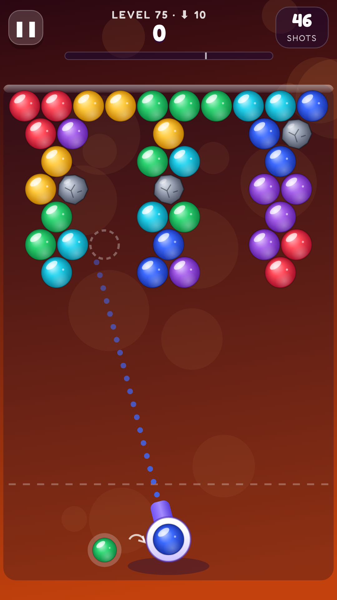
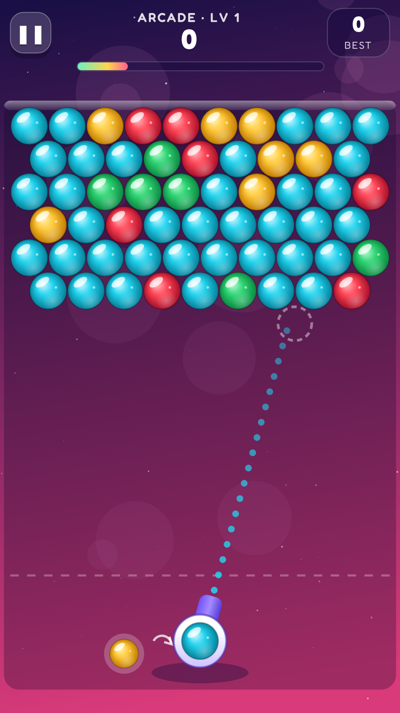
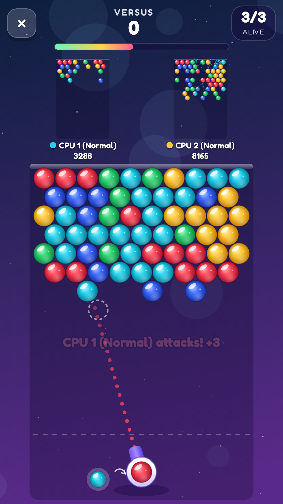

# Bubble Shooter Arena

A bubble shooter for Android with **200 levels**, an endless **Arcade** mode, and **local multiplayer for up to 4 players** over Wi-Fi. One phone hosts the match as a listen server and plays too; the other phones join.

<p>
  
  
  
</p>

## Features

- **Levels:** 200 levels across 10 worlds, with 1–3 stars each. From world 4, a steel ceiling drops every few shots. Every level was played by a bot during development to make sure it can be beaten within its shot limit.
- **Arcade:** a new row drops in on a timer. It gets faster and adds colors as you level up, and missed shots fill the timer faster.
- **Multiplayer (LAN listen server):**
  - The host phone runs the authoritative game server and also plays.
  - Up to 3 friends join over the same Wi-Fi or the host's hotspot. Games are found automatically, or you can join by IP address.
  - Popping and dropping bubbles sends garbage bubbles to your rivals. The last player standing wins.
  - You can fill empty slots with CPU players (Easy, Normal or Hard), or play **Vs CPU** offline.
- **Power-ups:** big combos earn a bomb (clears everything nearby, even stones) or a rainbow bubble (matches any color).
- **Polish:**
  - Aim guide with wall bounces and a landing preview.
  - Chain-pop effects, haptics, and synthesized sound effects and music (no audio files needed).
  - Color-blind symbols.
  - Works offline, with no ads, accounts or tracking.

## Project layout

| Path | What it is |
| --- | --- |
| `web/` | The game in TypeScript (Canvas 2D), built with Vite. All gameplay, UI, AI and multiplayer logic lives here. |
| `web/src/core/` | Rendering-free rules: hex grid, shot physics, matching, levels, scoring, bot. |
| `web/src/net/` | Multiplayer: protocol, authoritative `MatchServer`, `MatchClient` replica, transports. |
| `android/` | Native Android shell (Java, no third-party libraries). It hosts the game in a WebView and provides TCP sockets plus UDP discovery for multiplayer (`NetBridge.java`). |
| `store/` | Play Store icon, feature graphic and screenshots. |
| `docs/` | Privacy policy and the Play Store release guide. |
| `tools/store-assets.cjs` | Regenerates launcher icons and store graphics. |

## Build

You need Node 20+ and JDK 17. For local Android builds you also need the Android SDK (Android Studio installs it).

```bash
# 1. Build the game
cd web
npm ci
npm test          # unit + multiplayer tests
npm run build     # outputs web/dist

# 2. Build the Android app (copies web/dist into the APK automatically)
cd ../android
./gradlew assembleDebug        # app/build/outputs/apk/debug/
./gradlew bundleRelease        # app/build/outputs/bundle/release/  (upload this to Play)
```

To play in a desktop browser while developing, run `cd web && npm run dev`.

In a browser, multiplayer works between tabs of the same browser (test mode). On phones it uses real Wi-Fi networking.

**No computer?** Every push runs GitHub Actions (`.github/workflows/android.yml`), which builds the debug APK and the release AAB. Download them from the run's **Artifacts** section and install the debug APK on your phone.

## Multiplayer details

- The host opens TCP port **47777** and answers discovery broadcasts on UDP port **47778**.
- All phones must be on the same network. A phone hotspot works: the host can turn on its hotspot and the others connect to it.
- The host simulates every board. Phones send only their aim angle, and the host broadcasts the results, so the game can't be cheated or fall out of sync. Each client checks its copy against a hash and asks for a fresh copy if they ever differ.
- Some public or guest Wi-Fi networks block devices from talking to each other. Use a home network or a hotspot instead.

## Releasing on Google Play

See **[docs/PLAY_STORE.md](docs/PLAY_STORE.md)**. It covers the signing key, GitHub secrets, version codes, store listing text, Data safety answers and the content rating.

## Regenerating levels

Levels are generated from shape and color templates in `web/src/core/levels.ts`. After changing them, run `cd web && npm run calibrate`. A bot plays every level 9 times and rewrites the shot limits and star thresholds in `levelCalib.ts`.
